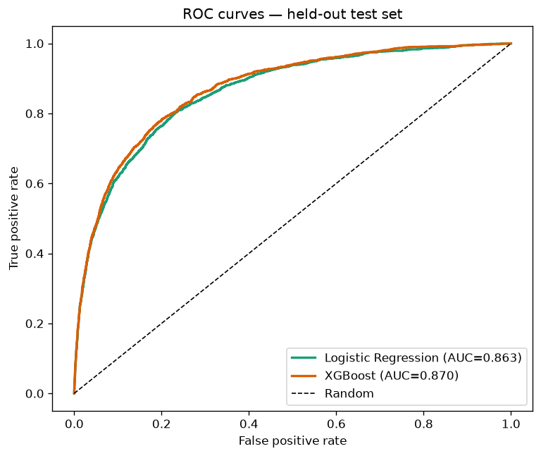
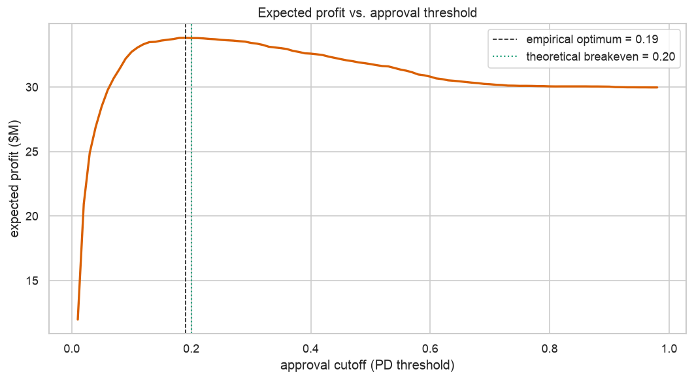
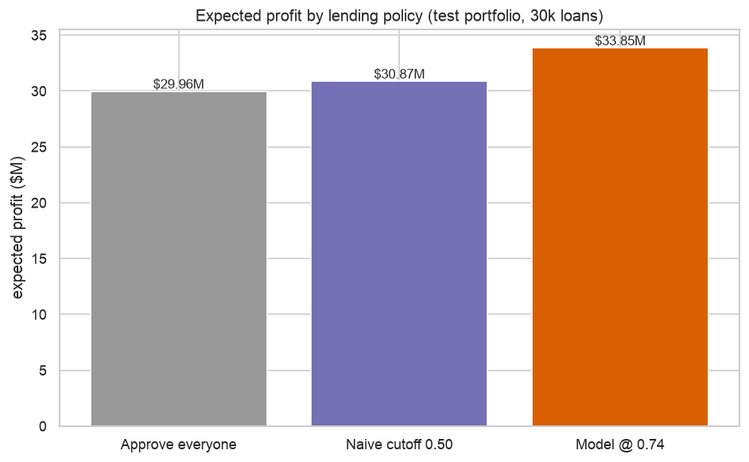

# Credit Risk Model — Predicting Consumer Loan Default

An end-to-end credit risk analytics project: from raw borrower data to a validated
probability-of-default (PD) model and the business decisions that follow from it
(approve/decline thresholds, expected loss, and pricing).

**Author:** _your name_ · **Stack:** Python, pandas, scikit-learn, XGBoost, Jupyter

> **TL;DR:** A gradient-boosted model predicts loan default with **AUC 0.87 / KS 0.58**,
> and the resulting approve/decline policy is worth **~$3.9M** more than approving everyone
> on a held-out 30,000-loan portfolio — with explainable per-borrower decisions.

---

## Why this project

Lenders make money by approving borrowers who repay and lose money on those who default.
The core task of consumer credit risk is estimating **P(default)** accurately, then turning
that estimate into decisions. This project does both — modeling *and* the economics behind
the cutoff.

## Data

**Give Me Some Credit** (Kaggle) — 150,000 anonymized borrower records, 10 features,
target `SeriousDlqin2yrs` (financial distress within 2 years).

- Default rate: **6.7%** (imbalanced — handled explicitly)
- Missing: `MonthlyIncome` ~20%, `NumberOfDependents` ~2.6%

Raw data is **not** committed (see `.gitignore`). Download instructions in `data/README.md`.

## Project structure

```
credit-risk-model/
├── data/
│   ├── raw/            # source CSV (gitignored)
│   └── processed/      # cleaned/feature sets (gitignored)
├── notebooks/
│   ├── 01_data_understanding.ipynb
│   ├── 02_eda.ipynb
│   ├── 03_feature_engineering.ipynb
│   ├── 04_modeling.ipynb
│   └── 05_business_impact.ipynb
├── src/                # reusable functions imported by notebooks
├── reports/
│   ├── figures/        # exported charts
│   └── SUMMARY.md      # plain-English write-up
├── models/             # saved models (gitignored)
├── requirements.txt
└── README.md
```

## Approach (high level)

1. **Data understanding & cleaning** — data types, missingness patterns, outliers, sentinel values.
2. **EDA** — distribution of default by feature; the variables that actually carry signal.
3. **Feature engineering** — ratios, delinquency aggregations, missing-value indicators.
4. **Modeling** — logistic regression (interpretable baseline) vs. gradient boosting (XGBoost);
   class imbalance handled with class weights; proper train/validation split.
5. **Evaluation** — AUC/ROC, KS statistic, precision-recall (rare event), calibration.
6. **Business impact** — cost-sensitive threshold selection, expected loss, and a simple
   approve/decline policy with dollar framing.

## Interactive demo

Try the model live — adjust a borrower profile and see the PD, decision, and reasons:

```bash
conda activate credit-risk
streamlit run app/streamlit_app.py
```

## Reproduce

```bash
pip install -r requirements.txt
jupyter lab
```

## Results

Trained on 120,000 borrowers, evaluated on a **held-out** 30,000 (stratified 80/20 split).
Default rate in both sets: **6.68%**.

| Model | Test AUC | Test KS |
|---|---|---|
| Logistic Regression (baseline) | 0.863 | 0.571 |
| **XGBoost (chosen)** | **0.870** | **0.583** |

**What drives default** (by model importance): prior delinquency — especially
`total_past_due` and `has_any_delinq` — followed by credit utilization. The top predictors
are the **domain features we engineered**, confirming the feature work paid off. This matches
the EDA: one 90+ day delinquency lifts the default rate from ~4.6% to **41%**.

**Business impact.** Treating each approved good loan as **+$1,500** profit and each approved
default as **−$6,000** loss (illustrative, $10k exposure × 60% LGD), the theoretical breakeven
PD is **0.20** (`1500 / (1500 + 6000)`) and the empirical profit-maximizing cutoff is **PD ≈ 0.19**:

| Policy | Approved | Expected profit |
|---|---|---|
| Approve everyone | 30,000 | $29.96M |
| Model @ optimal cutoff (0.19) | 27,137 | **$33.81M** |

➡️ The model-based policy adds **≈ $3.9M** of expected profit versus approving everyone on
just this 30,000-loan test portfolio — while catching the highest-risk borrowers. A logistic
**scorecard** provides per-borrower reason codes for explainable declines.

| Chart | What it shows |
|---|---|
|  | Model separation (AUC) |
|  | Optimal approval cutoff |
|  | Dollar value of the policy |

See **[reports/SUMMARY.md](reports/SUMMARY.md)** for the plain-English walkthrough.

## Key decisions (and why)

- **Imbalanced target (~6.7%)** → used `class_weight` / `scale_pos_weight` and judged on
  **AUC / KS / PR-AUC**, never accuracy.
- **Sentinel codes (96/98)** in delinquency columns → treated as missing **and flagged**
  (the flag preserves signal), then imputed as 0.
- **Missing income (~20%)** → median imputation **plus a missing-indicator** feature, because
  missingness itself is informative.
- **Extreme outliers** (utilization up to 50,000) → winsorized at the 1st/99th percentile.
- **Leakage control** → model scaling is fit in-pipeline on training folds only.
  Imputation medians and winsorize bounds are computed on the full dataset before the
  split (a small, acknowledged leak — noted as a deliberate simplification).

## Status

✅ Complete — end-to-end pipeline, models, evaluation, and business-impact analysis.
